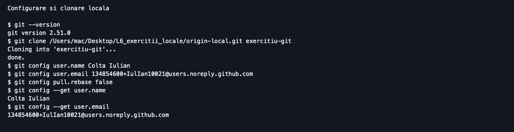
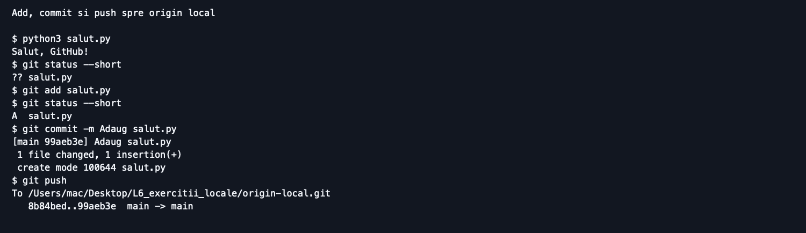
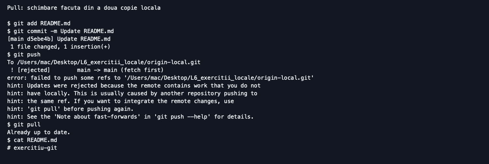
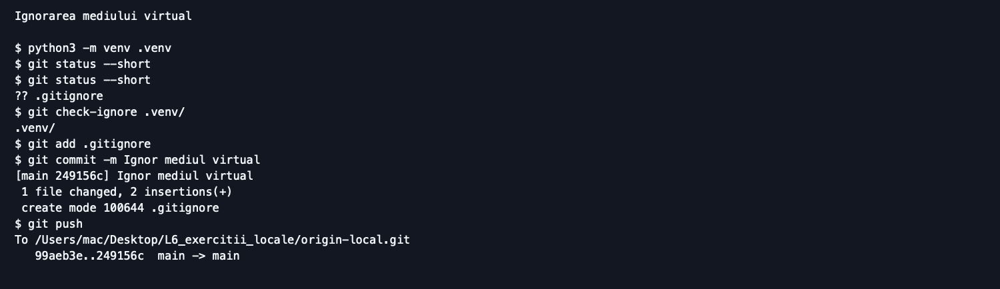
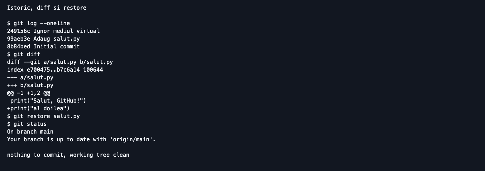
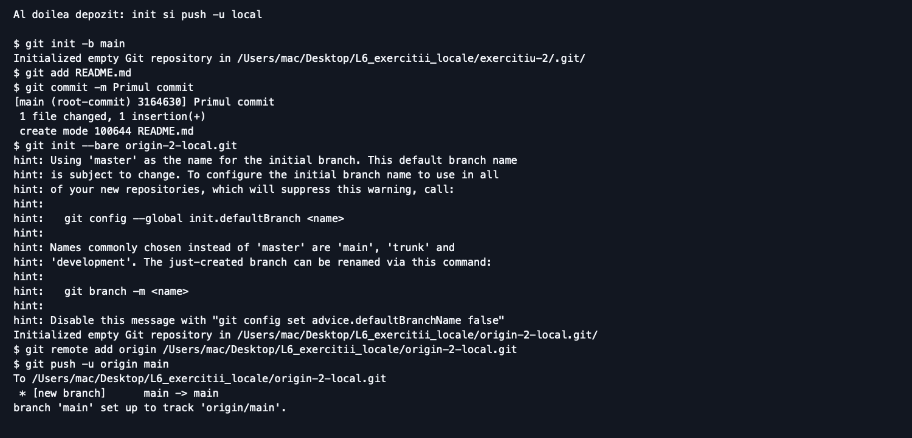
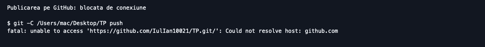

# Laboratorul 6. GitHub, pas cu pas

**Student:** Colta Iulian  
**Grupa:** SI-265  
**GitHub:** IulIan10021

## Starea realizării

Publicarea pe GitHub nu a putut fi efectuată: terminalul a returnat „Could not resolve host: github.com”. Exercițiile de transfer au fost executate cu depozite bare locale, fără a pretinde că sunt depozite publice. Vizibilitatea depozitului disciplinei și accesul profesorului nu au putut fi verificate.

## Linkuri

- Disciplina: https://github.com/IulIan10021/TP (vizibilitate neverificată).
- https://github.com/IulIan10021/exercitiu-git (publicare neconfirmată).
- https://github.com/IulIan10021/exercitiu-2 (publicare neconfirmată).

## Pașii efectuați

### A1. Contul GitHub

Am utilizat numele contului existent IulIan10021; autentificarea online nu a putut fi confirmată.

### A2. Configurarea Git

Am verificat versiunea Git și am configurat local identitatea Colta Iulian cu adresa GitHub noreply existentă.

### A3. Primul depozit

Am pregătit un depozit bare local cu README.md; crearea depozitului public pe GitHub rămâne de efectuat.

### A4. Clonarea

Am clonat depozitul local în exercitiu-git și am verificat conținutul.

### A5. Primul commit

Am creat salut.py, am rulat programul și am folosit status, add și commit.

### A6. Push

Am trimis commit-ul către origin local; trimiterea pe GitHub este blocată de conexiune.

### A7. Pull

Am modificat README.md dintr-o a doua copie locală și am adus schimbarea cu git pull.

### A8. .gitignore

Am creat mediul virtual și am salvat regulile .venv/ și __pycache__/; git check-ignore confirmă ignorarea.

### A9. Log și diff

Am verificat patru commit-uri, am adăugat temporar un rând în salut.py și l-am eliminat cu git restore.

### A10. Al doilea depozit

Am inițializat local exercitiu-2, am creat README.md și am folosit push -u către un al doilea origin local.

### Figura 1. Configurare si clonare locala

Configurarea și clonarea sunt realizate local. Origin este un folder de pe calculator.

### Figura 2. Add, commit si push spre origin local

Programul afișează Salut, GitHub!; fișierul trece din starea untracked în staged, apoi este salvat prin commit.

### Figura 3. Pull: schimbare facuta din a doua copie locala

Modificarea README.md provine din a doua copie locală. Pull aduce schimbarea prin fast-forward.

### Figura 4. Ignorarea mediului virtual

Regulile împiedică includerea mediului virtual și a cache-ului Python în commit-uri.

### Figura 5. Istoric, diff si restore

Istoricul are patru commit-uri. Diff arată rândul adăugat, iar restore readuce fișierul la versiunea salvată.

### Figura 6. Al doilea depozit: init si push -u local

Depozitul este pornit prin git init. Opțiunea -u configurează urmărirea ramurii main din origin local.

### Figura 7. Publicarea pe GitHub: blocata de conexiune

Încercarea reală de git push către depozitul disciplinei a eșuat din cauza rezolvării DNS.

## Surse și ajutor

Fișa laboratorului și modelul Word indicat. Ajutor Codex la executarea comenzilor, organizarea raportului și redarea transcrierilor. Imaginile sunt redări ale rezultatelor reale, nu capturi din GitHub. Istoricul original este păstrat în exemple/*.bundle; copiile de lucru sunt în /Users/mac/Desktop/L6_exercitii_locale.
